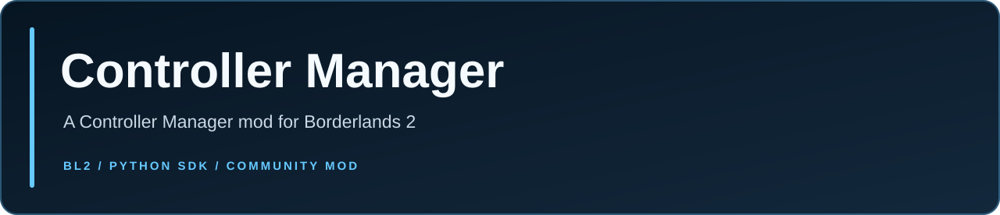

  <a href="#features">Features</a> ·
  <a href="#installation">Installation</a> ·
  <a href="#usage">Usage</a> ·
  <a href="#compatibility">Compatibility</a> ·
  <a href="#documentation">Documentation</a>

---

## Features

- Create separate controller button layouts for **Walking** and **Driving**, with automatic switching.
- Adjust horizontal and vertical sensitivity for hip-fire, aiming down sights, and vehicles.
- Assign controller shortcuts to compatible SDK mod actions, with optional **Start** or **Back** modifiers.
- Customize controller bindings without changing your keyboard controls.

## Installation

1. Install [PythonSDK and Willow2 Mod Manager](https://bl-sdk.github.io/willow2-mod-db/).
2. Close Borderlands 2 and back up your existing `sdk_mods/ControllerManager/` folder and saved SDK settings.
3. When a **Player ZIP** is published, extract its `ControllerManager/` folder into `Borderlands 2/sdk_mods/`. Remove duplicate or old numbered installations.
4. Confirm `sdk_mods/ControllerManager/__init__.py`, then launch the game and enable **Controller Manager** in the SDK Mods menu.

**Availability:** No public Player ZIP has been published yet. GitHub's automatic source ZIP is not an installable Player package.

See the [user guide](docs/USER_GUIDE.md#install-update-or-rollback) for updates, rollback, and troubleshooting.

## Usage

1. Enable **Use Custom Bindings** to activate separate Walking and Driving controller layouts.
2. Open **Walking** or **Driving** to change button assignments and sensitivity.
3. Open **Mod Shortcuts** to bind compatible SDK mod actions to controller buttons.

**Note:** Mod shortcuts require Controller Manager to be enabled, but work even when **Use Custom Bindings** is Off. [Controls and shortcut details](docs/USER_GUIDE.md#mod-shortcuts).

## Compatibility

**Windows Borderlands 2 with a local controller** is the primary Player target. Co-op input separation, The Pre-Sequel, and Proton/Wine remain unverified; native Linux BL2 is unsupported by this package.

Controller Deadzone Control is optional. Avoid running older Controller Customizer or Controller Binds mods alongside Manager. Other mods' shortcuts retain their own gameplay and co-op restrictions. [Compatibility details](docs/USER_GUIDE.md#compatibility-and-limitations).

## Documentation

[User guide](docs/USER_GUIDE.md) · [Troubleshooting](docs/USER_GUIDE.md#troubleshooting) · [Report an issue](https://github.com/PeytonBlakeslee/ControllerManager/issues) · [MIT license](LICENSE) · [Third-party notices](THIRD_PARTY_NOTICES.md)

---

Other Borderlands 2 mods

- [No Warp Tunnel](https://github.com/PeytonBlakeslee/NoWarpTunnel)
- [Auto Pickup](https://github.com/PeytonBlakeslee/AutoPickup)
- [Loot Recovery](https://github.com/PeytonBlakeslee/LootRecovery)
- [Controller Deadzone Control](https://github.com/PeytonBlakeslee/ControllerDeadzone)
- [OmniMovement](https://github.com/PeytonBlakeslee/OmniMovement)

